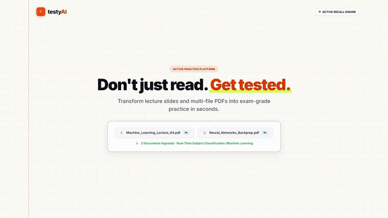
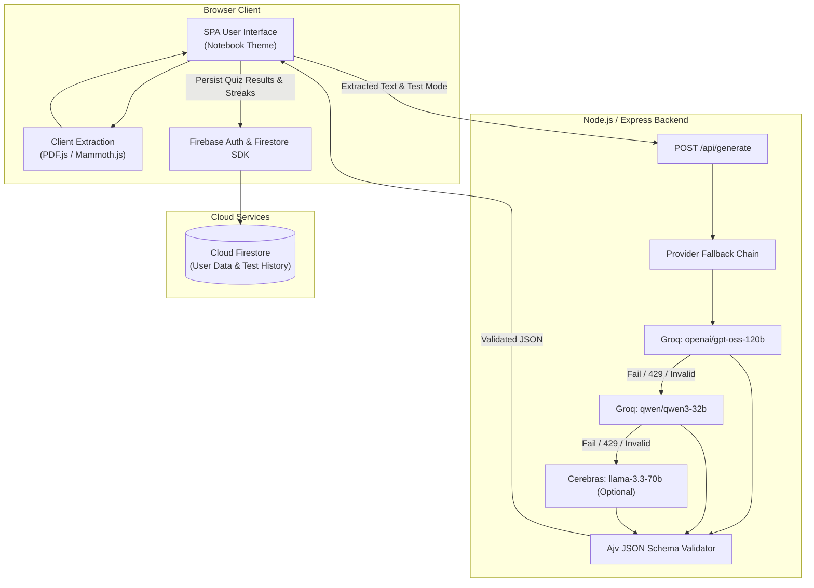

# testyAI — AI-Powered Study & Exam Prep Platform

> Transform lecture notes, slides, and multi-file PDFs into active-recall flashcards, auto-graded quizzes, and diagnostic mastery analytics in seconds.

[](https://testyai.onrender.com)
[](https://github.com/himani-2-git/testyAI)
[](https://nodejs.org/)
[](https://expressjs.com/)
[](https://firebase.google.com/)
[](https://groq.com/)
[](https://ajv.js.org/)
[](LICENSE)

---

### Quick Links
- **Live Web Application**: [https://testyai.onrender.com](https://testyai.onrender.com)
- **Source Code Repository**: [https://github.com/himani-2-git/testyAI](https://github.com/himani-2-git/testyAI)

---

## Project Walkthrough

<p align="center">
  
</p>

---

## Overview & Problem Solved

Passive re-reading of textbooks and lecture slides creates an **illusion of competence**: students feel familiar with material while reading, yet struggle to retrieve concepts during exams. Research in cognitive science consistently demonstrates that **active recall** and **spaced retrieval practice** produce superior retention and exam performance.

**testyAI** bridges this gap. It turns passive study notes into an interactive, gamified testing engine:
1. **Drop Any Study Material**: Upload lecture notes, chapter summaries, or multi-file PDFs spanning distinct subjects.
2. **Generate Targeted Practice**: Instantly receive structured flashcards, multiple-choice quizzes with explanations, or long-form conceptual questions.
3. **Diagnose Weak Spots**: View diagnostic mastery metrics that separate confirmed strengths from topics requiring urgent revision before exam day.

---

## Key Features

### 1. Client-Side Multi-Format Document Ingestion
- **Multi-File Uploads**: Ingest multiple documents simultaneously (e.g., *Machine_Learning_Lecture_04.pdf* alongside *Neural_Networks.pdf*).
- **Format Flexibility**: Supports **PDF** (via PDF.js), **DOCX** (via Mammoth.js), and plain **TXT** files.
- **Client-Side Privacy & Speed**: Text extraction executes entirely inside the user's browser, preventing slow file uploads and bandwidth overhead.
- **Automatic Subject Partitioning**: The server-side pipeline automatically identifies academic domains (`Machine Learning`, `Mathematics`, `Sciences`, `English`) across uploaded materials.

### 2. Three Active-Recall Practice Modes
- **3D Interactive Flashcards**:
  - Tactile 3D perspective flip cards with front question and verified back concept answer.
  - Full keyboard shortcuts: `Space` or `Enter` to flip; `ArrowLeft` / `ArrowRight` to navigate between cards; card indicator dots.
- **Multiple-Choice Quizzes (MCQ)**:
  - 4-option test format with immediate color-coded answer validation upon selection.
  - Detailed explanation drawer breaking down why the correct option is right.
  - Automatically calculates percentage score, performance tier, and persists attempt history to Cloud Firestore.
- **Exam-Grade Long Answers**:
  - Structured model exam solutions with numbered answer keys.
  - Expandable accordion cards with key point checklists and hint bullets.

### 3. Diagnostic Mastery Dashboard & Streaks
- **Dynamic Subject Filtering**: Switch between topic performance across all subjects or filter specifically by category (`Machine Learning`, `English`, `Mathematics`, etc.).
- **Three-Band Topic Diagnostics**:
  - **Areas to Improve (below 60%)**: Lowest-accuracy topics first, to target knowledge gaps before exams.
  - **Developing (60-74%)**: Not flagged either way; these topics are close and need steady practice.
  - **Your Strengths (75% and above)**: Highest-accuracy topics first.
  - Thresholds are named constants in `public/js/analytics.js` and covered by unit tests.
- **Study Streak Tracking**: Consecutive daily study session counter with motivational badges.
- **10-Quiz Score Progression**: Historical score trend chart tracking accuracy across recent attempts.

### 4. Multi-Provider AI Fallback Pipeline & Ajv Validation
- **Zero Client Credential Exposure**: AI vendor keys live exclusively in server-side environment variables — never delivered to the client.
- **Sequential Fallback Architecture** (`api/providers/index.js`):
  1. **Groq Primary**: `openai/gpt-oss-120b` (high-capacity reasoning via `GROQ_API_KEY`).
  2. **Groq Secondary**: `qwen/qwen3-32b` by default, overridable with `GROQ_FALLBACK_MODEL` (uses `GROQ_API_KEY_2` or the primary key).
  3. **Cerebras Tertiary**: `llama-3.3-70b` (ultra-fast inference via `CEREBRAS_API_KEY`, active when configured).
- **Strict JSON Schema Validation (Ajv)**:
  - Every model response is compiled and validated against formal JSON Schemas using **Ajv**.
  - Type-specific rules enforce structure (e.g., MCQs must contain exactly 4 options and valid answer keys).
  - If a provider triggers rate limits (HTTP 429) or returns malformed JSON, the pipeline catches the error and falls through to the next provider.

---

## Technology Stack

| Layer | Technologies | Purpose |
|---|---|---|
| **Frontend UI** | HTML5, CSS3, Vanilla JavaScript | Academic notebook paper theme, responsive layouts, 3D CSS transforms |
| **Document Processing** | [PDF.js](https://mozilla.github.io/pdf.js/), [Mammoth.js](https://github.com/mwilliamson/mammoth.js) | In-browser PDF and DOCX text extraction |
| **Backend / Runtime** | Node.js (v18+), Express 4.19 | REST API endpoints, SPA static routing, environment isolation |
| **AI Inference** | [Groq](https://groq.com/), [Cerebras](https://cerebras.ai/) | High-speed LLM inference (`gpt-oss-120b`, `qwen3-32b`, `llama-3.3-70b`) |
| **Validation** | [Ajv (Another JSON Schema Validator)](https://ajv.js.org/) | Compiles JSON Schemas to validate model outputs before client delivery |
| **Database & Auth** | Google Firebase (Auth & Cloud Firestore) | Google/Email authentication, test results, topic performance, and streak persistence |
| **Icons** | [Google Material Symbols](https://fonts.google.com/icons) (Rounded, Apache-2.0) | Consistent, accessible UI icons |

---

## Architecture & Project Structure

### Data & Execution Flow



### Directory Structure

```
testyAI/
├── api/
│   ├── providers/
│   │   └── index.js             # Provider list + fallback chain (Groq, Groq secondary, Cerebras)
│   ├── generate.js              # POST /api/generate route handler and input validation
│   ├── prompts.js               # Subject-aware system prompts
│   └── schemas.js               # JSON Schemas + compiled Ajv response validation
├── public/                      # The only directory served to browsers
│   ├── css/shared.css           # Theme tokens, layout, icon styles
│   ├── js/
│   │   ├── analytics.js         # Pure logic: streaks, topic ranking, note budgeting (unit-tested)
│   │   ├── config.js            # Firebase init and the /api/generate client
│   │   ├── db.js                # Firestore reads/writes (attempts are saved in one transaction)
│   │   └── ui.js                # icon() helper for Material Symbols
│   ├── app.html                 # Generator and practice UI
│   ├── dashboard.html           # Analytics dashboard
│   └── index.html               # Sign-in page
├── tests/                       # node:test unit tests (npm test)
├── docs/demo.gif                # Walkthrough
├── firestore.rules              # Per-user data isolation rules
├── server.js                    # Express server: rate limiting, API, static files
├── .env.example
└── package.json
```

---

## Local Setup & Environment Configuration

### Prerequisites
- [Node.js](https://nodejs.org/) (v18.0.0 or higher recommended)
- [npm](https://www.npmjs.com/) (bundled with Node.js)
- A [Groq Cloud API Key](https://console.groq.com/)
- *(Optional)* A secondary Groq API key and/or a [Cerebras API Key](https://inference.cerebras.ai/) for multi-provider fallback
- A [Firebase Project](https://console.firebase.google.com/) with **Authentication** and **Cloud Firestore** enabled

### 1. Clone the Repository
```bash
git clone https://github.com/himani-2-git/testyAI.git
cd testyAI
```

### 2. Install Dependencies
```bash
npm install
```

### 3. Configure Environment Variables
Create your local `.env` file from the provided template:

**On Linux / macOS:**
```bash
cp .env.example .env
```

**On Windows (PowerShell):**
```powershell
Copy-Item .env.example .env
```

Open `.env` and supply your API keys:
```ini
GROQ_API_KEY=gsk_your_primary_groq_api_key_here
GROQ_API_KEY_2=your_secondary_groq_api_key_here     # Optional
CEREBRAS_API_KEY=your_cerebras_api_key_here         # Optional
PORT=8080
```

### 4. Start the Application
For production runtime:
```bash
npm start
```

For development mode (auto-reloads on file changes using Node.js watch mode):
```bash
npm run dev
```

Open your browser and navigate to:
```
http://localhost:8080
```

---

## Firebase Setup & Security Configuration

### Client Configuration (`public/js/config.js`)
Frontend client credentials reside in `public/js/config.js`. Note that Firebase client config keys (`apiKey`, `authDomain`, `projectId`) are intended by design to be publicly accessible in client bundles:

```javascript
const firebaseConfig = {
  apiKey: "AIzaSy...",
  authDomain: "your-project.firebaseapp.com",
  projectId: "your-project",
  storageBucket: "your-project.appspot.com",
  messagingSenderId: "...",
  appId: "..."
};
```

### Security Rules (`firestore.rules`)
Because client keys are public, **database security and user data isolation must be enforced via Cloud Firestore Security Rules**.

testyAI includes a strict `firestore.rules` file restricting all database operations to authenticated owners:

```javascript
rules_version = '2';
service cloud.firestore {
  match /databases/{database}/documents {
    function isAuthenticated() {
      return request.auth != null;
    }
    function isOwner(userId) {
      return isAuthenticated() && request.auth.uid == userId;
    }

    match /users/{userId}      { allow read, write: if isOwner(userId); }
    match /analytics/{userId}  { allow read, write: if isOwner(userId); }
    match /tests/{testId} {
      allow create: if isAuthenticated() && request.resource.data.userId == request.auth.uid;
      allow read, delete: if isAuthenticated() && resource.data.userId == request.auth.uid;
      allow update: if isAuthenticated() && resource.data.userId == request.auth.uid && request.resource.data.userId == request.auth.uid;
    }
    match /{document=**}       { allow read, write: if false; }
  }
}
```

#### Deploying Rules
Deploy directly using the [Firebase CLI](https://firebase.google.com/docs/cli):
```bash
firebase deploy --only firestore:rules
```
*(Alternatively, copy and paste the contents of `firestore.rules` into the **Firestore Database** → **Rules** tab in the Firebase Console and click **Publish**).*

---

## Deployment Notes

### Deploying to Render
1. Connect your GitHub repository to [Render](https://render.com/).
2. Select **Web Service** with runtime **Node**.
3. Configure build and start commands:
   - **Build Command**: `npm install`
   - **Start Command**: `npm start`
4. In the **Environment** settings, add your `GROQ_API_KEY` (and optional `GROQ_API_KEY_2`, `CEREBRAS_API_KEY`).
5. Ensure your production URL (e.g., `https://testyai.onrender.com`) is added to **Firebase Console** → **Authentication** → **Settings** → **Authorized Domains**.

---

## Troubleshooting

- **AI Generation Fails ("All AI providers failed")**:
  - Verify that `GROQ_API_KEY` is properly populated in your `.env` file.
  - If you exceed rate limits on Groq's free tier, configure `GROQ_API_KEY_2` or `CEREBRAS_API_KEY` to enable seamless multi-provider fallback.
- **Firebase Permission Denied**:
  - Confirm you have deployed `firestore.rules` to your Firebase project.
  - Check that Google Sign-In and Email/Password providers are enabled in Firebase Authentication.
- **Large PDF Ingestion Delay**:
  - Processing is performed client-side using PDF.js. Very large scanned PDFs (e.g., >50 MB of raw scanned images) may require additional browser memory. Text-based PDFs process in seconds.

---

## Contributing

Contributions, feedback, and issue reports are welcome!

1. Fork the Project (`https://github.com/himani-2-git/testyAI/fork`)
2. Create your Feature Branch (`git checkout -b feature/NewFeature`)
3. Commit your Changes (`git commit -m 'feat: Add NewFeature'`)
4. Push to the Branch (`git push origin feature/NewFeature`)
5. Open a Pull Request

---

## License

This project is licensed under the [MIT License](LICENSE).
